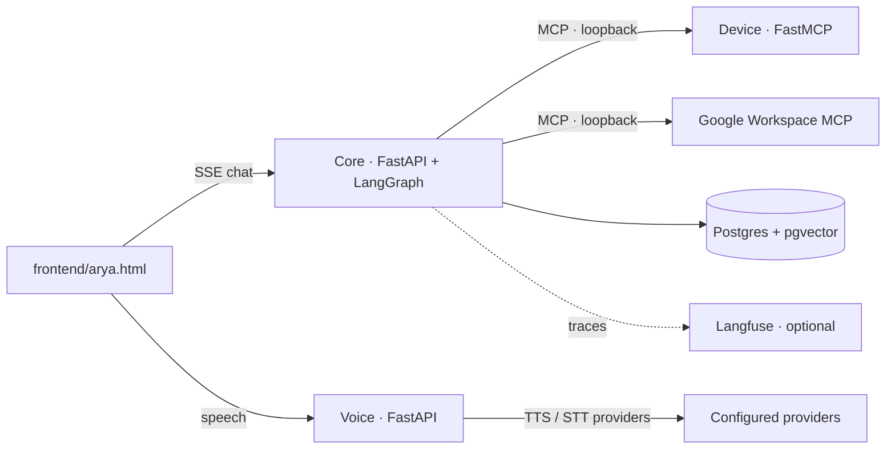

# ARYA

ARYA is a local-first voice and chat assistant for Windows. A Python core runs a
LangGraph conversation, while separate local services handle speech and desktop
actions. Google Workspace tools run in their own MCP process. PostgreSQL stores
conversation checkpoints and memory. The browser client is in `frontend/`.

## Architecture



The services bind to `127.0.0.1` by default. The device process serializes GUI
actions because those actions control the active Windows desktop.

## What it does

- Chat and voice conversations with streaming replies, wake-word handling,
  speech-to-text, and text-to-speech.
- Spotify and desktop controls through the device MCP server.
- Gmail, Calendar, and Contacts through an independently authorized Google
  Workspace MCP server.
- Weather, web search, and a safe calculator as native tools.
- Approval questions before protected side effects such as sending or deleting.
- A verifier that checks action and memory claims against actual tool outcomes.
- Optional Langfuse traces with PII-tokenised content.

## Status

ARYA has migrated from n8n to LangGraph. Advanced browser automation—shopping
carts, forms, and multi-step web tasks—is in progress and has not been ported.

### Memory and privacy

Memory uses five PostgreSQL stores: versioned entities, episodes, knowledge
chunks, procedures, and patterns. Hybrid retrieval combines vector and full-text
results. Forgotten procedures become inactive, disappear from reads and policy
checks, and are eventually purged; tombstones suppress accidental recreation.

The PII layer tokenises emails, phone numbers, and other detected personal
values before content is sent to models, embeddings, external speech providers,
or observability. A local encrypted vault maps those tokens back when a tool
must use the real value. Treat `.env`, local frontend config, and access tokens
as private credentials.

## Windows quick start

### Prerequisites

- Windows 10 or 11, Python 3.12, Git, and [`uv`](https://docs.astral.sh/uv/).
- PostgreSQL with `pgvector` and `pgcrypto` extensions available.
- Node.js only if you need to set up the separately installed Google Workspace
  MCP server.
- Credentials for the providers you intend to use. Google OAuth authorization
  is a manual one-time setup.

### Configure and start

In PowerShell, from the cloned repository:

```powershell
Copy-Item .env.example .env
notepad .env
uv sync --locked --extra observability --extra voice --extra device
psql -d arya -c "CREATE EXTENSION IF NOT EXISTS vector;"
psql -d arya -c "CREATE EXTENSION IF NOT EXISTS pgcrypto;"
uv run --env-file .env python db/apply_schema.py
.\deploy\start_all.ps1
```

Fill in `.env.example` values appropriate to your setup. Configure the Google
Workspace MCP using [`docs/RUNBOOK.md`](docs/RUNBOOK.md). To open the browser
client, in another PowerShell window run:

```powershell
.\scripts\serve_frontend.ps1
```

Then browse to <http://localhost:8080>. For optional Picovoice wake-word setup,
see [`frontend/README.md`](frontend/README.md). Without a Picovoice key, the
page uses the browser's Web Speech wake-word fallback where supported.

The search default is Tavily (`TAVILY_API_KEY`). `config/search.yaml` can select
Google Custom Search (`GOOGLE_SEARCH_API_KEY` and
`GOOGLE_SEARCH_ENGINE_ID`) or Brave. Google says Custom Search is closed to new
customers and will be discontinued on January 1, 2027. Existing local `.env`
settings can override the repository default.

## Tests and evaluations

```powershell
uv run pytest tests/unit -q
uv run python scripts/run_postgres_tests.py
uv run ruff check .
uv run python -m evals.run
```

The Postgres test runner creates a disposable database. Offline eval mode lists
the configured suites; `uv run python -m evals.run --live --models gpt-4o,gpt-4o-mini`
uses OpenAI and reports live results. Tests mock Google, provider HTTP calls,
and GUI operations.

### Secret scan before pushing

The scanner checks tracked files and all reachable Git history for provider
keys, non-placeholder email addresses, and phone numbers. It prints finding
locations and categories only, never matched values. Run it directly:

```powershell
.\scripts\check_secrets.ps1
```

To enable it as a local pre-push hook:

```powershell
git config core.hooksPath .githooks
```

Git then runs `.githooks/pre-push` before each push. A finding blocks the push;
rotate any exposed credential and handle historical secrets before publishing.

## Scope and safety

ARYA is a personal-use project, not production software. It can send messages,
change calendar data, and control your PC after approval. Review each approval
carefully, keep credentials private, and use test accounts or contacts while
evaluating side-effect tools. Do not run the device service in a session where
unexpected desktop automation would be unsafe.

See [`docs/RUNBOOK.md`](docs/RUNBOOK.md) for the detailed setup guide and
[`docs/MIGRATION.md`](docs/MIGRATION.md) for the component migration map.

## Quality and performance

Measured on a Windows PC against the OpenAI API on 2026-11-04 (commit `ee1a818`). Reproduce with:
`uv run python -m evals.run --models gpt-4o,gpt-4o-mini --live`

| Suite | Cases | gpt-4o-mini | gpt-4o | What it checks |
|---|---|---|---|---|
| Tool routing | 18 | 18/18 | 18/18 | Right tool for a spoken command |
| Memory routing | 46 | 46/46 | 45/46 | Which of the five memory stores to read or write |
| Approvals | 6 | 6/6 | 6/6 | Risky actions always pause for confirmation |
| Persona tone | 4 | 4/4 | 4/4 | No banned chatbot phrases |
| Exact reply | 1 | 1/1 | 1/1 | Follows a plain instruction exactly |
| Structured schemas | 3 | 3/3 | 3/3 | Strict output schemas accepted by the API |

Median time to the first text chunk of a model call: 656-1,040 ms (gpt-4o-mini) and 848-1,124 ms (gpt-4o), depending on the suite.

Tests: 135 unit tests, plus 35 integration tests that run against a real temporary PostgreSQL database (`scripts/run_postgres_tests.py`).

How to read these numbers: the suites are small regression sets written by the author for this project. They catch regressions (an earlier version of the memory router scored 13/30 on its first live run), but they do not measure real-world accuracy. The one gpt-4o miss is a comparison question it answered without a lookup, which is arguably acceptable. Latency is the model's first chunk in the eval harness, not end-to-end voice latency. Details in [docs/EVALS.md](docs/EVALS.md).

## Roadmap
- **Browser automation** (shopping, forms, multi-step web tasks via browser-use): not yet ported. The original service is kept in `legacy/arya_browser_api.py` for reference. Planned: a separate service with its own Chrome profile, exposed as a tool behind the same approval policy.
- Spotify Web API for true playback state (currently keyboard automation).
- Local speech-to-text (currently Groq Whisper).

